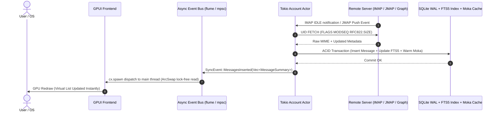

<div align="center">

# 🕊️ Vespetrel

### A Pure Rust, GPU-Rendered Desktop Mail Client
**Pre-1.0 • Multi-protocol (IMAP / JMAP / Graph) • Local FTS5 search • Native GPU UI**

[](https://www.rust-lang.org)
[](https://crates.io/crates/gpui-kit)
[](LICENSE)
[](https://github.com/SV-stark/Vespetrel/releases/tag/nightly)
[-orange.svg?style=flat-square)](https://www.sqlite.org/fts5.html)
[](https://github.com/SV-stark/Vespetrel/actions)
[](https://github.com/SV-stark/Vespetrel/pulls)

[Features](#-features) • [Architecture](#-architecture) • [Comparison](#-head-to-head-vs-thunderbird) • [Provider Support](#-provider-compatibility-matrix) • [Workspace](#-workspace-structure) • [Getting Started](#-getting-started) • [Roadmap](#-roadmap)

</div>

---

## ⚡ Why Vespetrel?

Modern desktop email clients are almost universally trapped in web runtimes (Electron, Gecko, Chromium) that consume gigabytes of memory, introduce sluggish typing latency, and struggle when searching 50k+ local mailboxes.

**Vespetrel** is a from-scratch desktop mail client written in Rust, using **`gpui-kit 0.8.1`** for a GPU-rendered native UI (no Electron, no embedded browser). It is pre-1.0: it already covers multi-protocol mail (IMAP, JMAP, Microsoft Graph, Gmail), OAuth2 sign-in, local SQLite FTS5 search, CalDAV/CardDAV and OpenPGP/S/MIME, but it is **not yet a Thunderbird replacement**. See the [honest comparison](#-vespetrel-vs-thunderbird-honest-comparison) and the [roadmap](#-roadmap--status) for what is and isn't done. Performance figures have not been benchmarked and are intentionally not claimed.

```
┌────────────────────────────────────────────────────────────────────────────────────────────┐
│                                   VESPETREL ARCHITECTURE                                   │
│                                                                                            │
│  ┌──────────────────────────────────────────────────────────────────────────────────────┐  │
│  │ GPUI-KIT 0.8.1 FRONTEND (GPU Metal / Vulkan / DirectX)                  │  │
│  │ • 3-Pane Dock Layout (Folders, Virtual Thread List, Message Viewer)                  │  │
│  │ • Interactive Setup Wizard (Input/InputState, masked password + eye toggle)         │  │
│  │ • Tree-sitter Rich Markdown/Plaintext Editor                 │  │
│  │ • Virtualized message list               │  │
│  └───────────────────────────────────────────┬──────────────────────────────────────────┘  │
│                                              │ Async Event Bus (flume bridge Tokio → GPUI)   │
│                                              ▼                                             │
│  ┌──────────────────────────────────────────────────────────────────────────────────────┐  │
│  │ TOKIO ASYNC SYNC CORE                                                                │  │
│  │ • Isolated Account Actors (IMAP IDLE, QRESYNC, CONDSTORE, JMAP RFC 8620/8621)        │  │
│  │ • Microsoft Graph REST Engine (Exchange Online)                     │  │
│  │ • Persistent SQLite Outbox (retry backoff + scheduled send + graceful shutdown)      │  │
│  │ • OAuth2 PKCE Browser Flow (127.0.0.1:0 loopback, CSRF + Host validation)           │  │
│  │ • PIM Engine (in-crate WebDAV + icalendar + vcard4 CalDAV/CardDAV)                   │  │
│  │ • Security: rPGP (OpenPGP RFC 9580 v6) + RustCrypto S/MIME + OS Keyring              │  │
│  └───────────────────────────────────────────┬──────────────────────────────────────────┘  │
│                                              │ Transactional Storage (deadpool-sqlite)     │
│                                              ▼                                             │
│  ┌──────────────────────────────────────────────────────────────────────────────────────┐  │
│  │ LOCAL STORAGE & BM25 SEARCH                                                          │  │
│  │ • Rusqlite in WAL Mode + Memory-Mapped I/O (quick_check verified)                   │  │
│  │ • SQLite FTS5 (unicode61 remove_diacritics) for local full-text search    │  │
│  │ • Moka TinyLFU Cache + ArcSwap lock-free UI state for lock-free UI state reads             │  │
│  │ • Compressed Raw RFC822 Blob Store (lz4 / zstd) for offline resilience               │  │
│  └──────────────────────────────────────────────────────────────────────────────────────┘  │
└────────────────────────────────────────────────────────────────────────────────────────────┘
```

---

## 🚀 Vespetrel vs. Thunderbird (Honest Comparison)

Vespetrel is **not** a drop-in Thunderbird replacement yet. It is a young, fast-moving client with a different design focus.

| Area | Thunderbird | Vespetrel (v0.2) |
|---|---|---|
| **Maturity** | 20+ years, large user base | Pre-1.0, single maintainer |
| **UI technology** | Gecko (HTML/XUL/JS) | Native Rust, GPU-rendered via `gpui-kit` |
| **Protocols** | IMAP, POP3, SMTP, NNTP, Exchange (EWS) | IMAP, SMTP, JMAP, Microsoft Graph, Gmail API (POP3 not yet) |
| **HTML email rendering** | Full web engine | Sanitize-only today; layout engine planned |
| **Filters / rules** | Mature | Planned |
| **Import / migration** | Broad | Planned |
| **Calendar & contacts** | Built in | CalDAV/CardDAV (no `RRULE` expansion) |
| **Encryption** | OpenPGP + S/MIME | OpenPGP (`rPGP`) + S/MIME validation |
| **Tracker blocking** | Remote content blocking | Built-in pixel stripping and remote-content block |
| **Extensions** | Large add-on ecosystem | None (plugin runtime planned) |
| **Accessibility, spell-check, printing** | Yes | Not yet |
| **Memory safety of core code** | C++ / JS | Rust |
| **Performance** | Mature, heavier footprint | Design goal is a lighter, faster client. **Not yet benchmarked**; no published numbers |

---

## 🔄 Real-Time Synchronization Pipeline



---

## 🌐 Provider Compatibility Matrix

Vespetrel natively abstracts differences between modern and legacy email protocols through its unified `MailProvider` trait:

| Provider | Auth Method | Email Protocol | Push / Sync Method | Calendar | Contacts |
|---|---|---|---|---|---|
| **Gmail / Google Workspace** | OAuth2 + PKCE | IMAP (`X-GM-EXT-1`) | IMAP IDLE | CalDAV | CardDAV |
| **Microsoft 365 (Enterprise)** | Entra ID OAuth2 | Microsoft Graph REST | Delta Tokens (`/messages/delta`) | Graph Events | Graph Contacts |
| **Outlook.com (Personal)** | OAuth2 + PKCE | IMAP / SMTP | IMAP IDLE | Graph Events | Graph Contacts |
| **Fastmail** | App Password / Bearer | JMAP (RFC 8620/8621) | EventSource (SSE) / WebSocket | CalDAV / JMAP | CardDAV / JMAP |
| **Apple iCloud** | App Password | IMAP / SMTP | IMAP IDLE | CalDAV | CardDAV |
| **Nextcloud** | Password / App Token | IMAP / SMTP | IMAP IDLE | CalDAV | CardDAV |
| **Self-Hosted (Dovecot / Stalwart)** | Plain / SCRAM / XOAUTH2 | IMAP4rev2 / JMAP | IMAP IDLE / Push | CalDAV | CardDAV |

---

### 🧙 Thunderbird-Style Zero-Friction Setup & Autodiscover
* **3-Field Instant Setup**: True Thunderbird simplicity. Users only enter **Your Name**, **Email Address**, and **Password** (or OAuth2 toggle). Vespetrel automatically detects optimal server protocols, hostnames, ports, and encryption without requiring manual provider selection.
* **Mozilla ISPDB & Active Autodiscover**: Native XML parser and live queries targeting Mozilla's Thunderbird ISP database (`https://autoconfig.thunderbird.net/v1.1/{domain}`) with intelligent heuristic fallback (`imap.{domain}:993` SSL/TLS, `smtp.{domain}:587` STARTTLS). Pre-configured global coverage for Google Workspace, Microsoft 365 / Exchange, Fastmail, Apple iCloud, Yahoo/AOL, Zoho, ProtonMail Bridge, GMX, WEB.DE, Mail.ru, Yandex, and OVH.
* **Zero-Configuration OAuth2**: Built-in public desktop client IDs for Google and Microsoft 365 Entra ID. Clicking "Sign in with Google" or "Sign in with Microsoft" instantly opens the browser with zero manual cloud project setup, alongside seamless fallback to App Password / IMAP mode.
* **Expandable Manual Configuration**: Thunderbird-style collapsible tray allowing users to inspect or override incoming/outgoing hostnames, ports, socket encryption (SSL/TLS vs STARTTLS), and run live "Re-test / Detect" probes.
* **Account Aliases & Identity Switching**: Full multi-alias support backed by dedicated SQLite schema (`account_aliases`). Compose and reply from any configured alias with automatic reply matching.
* **Rich In-App Attachment Previewer**: Inspect images, syntax-highlighted code/text, PDF metadata, audio/video codecs/duration, archive trees (ZIP/TAR/GZ), and vCard/iCal data without third-party viewers.
* **Custom Signatures with Variables**: Per-account rich signatures supporting dynamic placeholders (`{name}`, `{email}`, `{title}`, `{company}`, `{phone}`) with automatic compose injection.

### 🎨 7-Pillar Customization & Betterbird-Inspired
* **Diacritic-Insensitive Quick Filter**: Fast search across active folder lists with automatic accent folding (`é, à, ö, ü, ñ, ç, ß` → ASCII) and full `/regex/` pattern evaluation.
* **Multi-Template HTML Signatures**: Visual designer generating email-safe responsive HTML signatures across 4 templates (*Modern*, *Minimal*, *Corporate*, *Creative*) with avatars, social badges, and per-account assignment.
* **Per-Account & Folder Accent Colors**: Customizable color indicators persisted in SQLite for instant visual recognition across complex multi-account setups.
* **Multi-Density Message Rows**: User-selectable row density modes (`Compact` 32px, `Comfortable` 64px, `Roomy` 96px) matching user workspace preferences.
* **7-Pillar Settings Engine**: Comprehensive GUI preferences modal controlling Layout, Themes (Dark/Light/OLED Black), Typography, Triaging, Composer, Keyboard Shortcuts, and Privacy/Security.

### 📬 Mail Engine
* **Protocol Diversity**: Full support for standard **IMAP4rev2** (`IDLE`, `CONDSTORE`, `QRESYNC`, `SPECIAL-USE` with `VANISHED (EARLIER)` / `EXPUNGE` propagation and incremental UID sync), modern **JMAP** (RFC 8620/8621), and **Microsoft Graph REST** (for corporate Microsoft 365 environments where IMAP is disabled).
* **MIME Parsing**: Powered by `mail-parser` for zero-copy string slicing (`Cow<str>`), streaming attachments, and robust decoding of 41 legacy character sets.
* **OAuth2 with PKCE**: Built-in graphical authorization with ephemeral loopback callbacks (`127.0.0.1:0`), SHA-256 challenge + CSRF/Host validation, automated token rotation (60s proactive refresh), and credential storage in the OS credential manager (`keyring-rs` v4, non-blocking `spawn_blocking` load).
* **SMTP & Delivery**: High-throughput transmission via `lettre` with `send_live` + XOAUTH2, automated DKIM signing (`aws-lc-rs`, RFC 6376 relaxed/relaxed) and Autocrypt 1.1 header injection. Outbound mail queues in the persistent SQLite outbox.

### 🛡️ Security & Privacy First
* **Tracker Shield**: Real-time streaming HTML rewriter (`lol_html`) strips remote tracking pixels (1x1 transparent GIFs), tracking URL queries, and un-sanitized script/form tags.
* **Remote Content Blocker**: Remote images, styles, `srcset`, and `poster` attributes are blocked by default until explicitly trusted per sender. Strict CSP + CID rewrite in the sandboxed viewport.
* **End-to-End Encryption**: Pure Rust **`rPGP`** implementation supporting OpenPGP RFC 9580 (v6 keys & AEAD, PGP/MIME verified, no mock fallback) and Autocrypt 1.1 key exchange, alongside `RustCrypto` S/MIME X.509 DER validation (strict PKCS/CMS OID + ASN.1).
* **Hardening**: Deterministic FNV-1a `stable_uid_from_id` (no restart collisions), symlink-traversal guard + corrupt-account quarantine + transactional signatures, 16MB IMAP response cap with zero-alloc fetch parsing, `webpki-roots` TLS, `cargo-deny` supply-chain audit (`openssl-sys` banned, unknown registries denied).

### 📅 Integrated PIM (Calendar, Contacts & Tasks)
* **CalDAV**: Direct two-way sync with Google Calendar, Nextcloud, Fastmail, and Apple iCloud. WebDAV requests, XML multistatus parsing and `icalendar` (RFC 5545) handling are implemented in-crate on `reqwest`. `RRULE` expansion is not implemented; recurring series round-trip verbatim.
* **CardDAV**: Address book synchronization with auto-complete chips in the compose editor (`vcard4` RFC 6350).
* **Tasks Engine**: Full RFC 5545 `VTODO` task tracking with due dates, priority, status filters, and CalDAV synchronization.

---

## 📦 Workspace Structure

Vespetrel is architected as a highly modular Cargo workspace:

```
vespetrel/
├── Cargo.toml                  # Workspace manifest & shared dependencies (gpui-kit 0.8.1, aws-lc-rs)
├── rust-toolchain.toml         # Pinned stable Rust toolchain
├── packaging/                  # Native packaging: windows/ (.nsi + manifest), linux/ (.desktop), macos/ (Info.plist)
├── .github/workflows/          # CI matrix (fmt + clippy + test + release build + headless verify + cargo-deny audit) & nightly release
├── crates/
│   ├── vespetrel-app/          # gpui-kit entrypoint, dock layout, virtual lists, login wizard modal, settings & UI
│   ├── vespetrel-core/         # Domain models (Account, Message, Settings, HTML Signatures, Thread, Contact) + stable_uid
│   ├── vespetrel-storage/      # Rusqlite WAL storage, FTS5 BM25 search, Moka cache, LZ4/Zstd blob store, outbox tables
│   ├── vespetrel-engine/       # Tokio sync coordinator, account worker actors, persistent outbox & Flume event bridge
│   ├── vespetrel-imap/         # IMAP client actor with IDLE, CONDSTORE, QRESYNC & XOAUTH2
│   ├── vespetrel-jmap/         # JMAP client adapter (RFC 8620/8621)
│   ├── vespetrel-graph/        # Microsoft Graph REST client for Exchange Online
│   ├── vespetrel-smtp/         # Lettre submission engine with DKIM & Autocrypt
│   ├── vespetrel-dav/          # CalDAV / CardDAV sync engine (in-crate WebDAV + icalendar)
│   ├── vespetrel-crypto/       # rPGP OpenPGP (RFC 9580), S/MIME, Autocrypt 1.1 & OS keyring
│   └── vespetrel-render/       # SIMD UTF-8 HTML sanitization (ammonia, lol_html), auth badges, MDN, cleaner & anti-phishing
```


---

## 🛠️ Getting Started

### Prerequisites
* **Rust**: Pinned stable toolchain (1.85+ / 2024 edition) via `rustup` (+ `rustfmt`, `clippy` components for CI).
* **C Compiler / Build Tools**:
  * **macOS**: Xcode Command Line Tools (`xcode-select --install`)
  * **Linux**: `libkeyutils-dev libdbus-1-dev pkg-config libssl-dev libfontconfig1-dev libxkbcommon-dev libxkbcommon-x11-dev libxcb1-dev libxcb-shape0-dev libxcb-xfixes0-dev libxcb-render0-dev` (required by `gpui-kit` + `keyring` — see `.github/workflows/ci.yml`)
  * **Windows**: Visual Studio 2022 C++ Build Tools

### 📥 Downloads (Windows Nightly)

Pre-built rolling releases are built and published on every push to `main`:

| Package | Format | Direct Download |
|---|---|---|
| **Windows Setup Installer** | `.exe` (NSIS) | [**`vespetrel-setup-windows-x86_64.exe`**](https://github.com/SV-stark/Vespetrel/releases/download/nightly/vespetrel-setup-windows-x86_64.exe) |
| **Portable Archive** | `.zip` | [**`vespetrel-windows-x86_64.zip`**](https://github.com/SV-stark/Vespetrel/releases/download/nightly/vespetrel-windows-x86_64.zip) |

| **Checksums** | `SHA256` | [**`SHA256SUMS.txt`**](https://github.com/SV-stark/Vespetrel/releases/download/nightly/SHA256SUMS.txt) |

---

### Building from Source

Ensure you have Rust (>= 1.85 / 2024 edition) installed:

```bash
# Clone the repository
git clone https://github.com/SV-stark/Vespetrel.git
cd Vespetrel

# Update dependencies
cargo update

# Verify workspace compilation
cargo check

# Run tests across storage, crypto, render, and protocol crates (100+ tests)
cargo test --workspace

# Build optimized release binaries
cargo build --release --workspace

# Launch Vespetrel desktop client in headless validation mode
cargo run --package vespetrel-app -- --memory

# Headless startup check (CI verify) / custom DB / verbose logging
cargo run --release -p vespetrel-app --bin vespetrel -- --memory
cargo run --package vespetrel-app -- --db "C:\Users\you\AppData\Local\Vespetrel\vespetrel.db"
cargo run --package vespetrel-app -- --headless
cargo run --package vespetrel-app -- --verbose
```

Default database locations: `%LOCALAPPDATA%\Vespetrel\vespetrel.db` (Windows) or `~/.local/share/vespetrel/vespetrel.db` (macOS/Linux); blobs live in a sibling `blobs/` dir (temp dir for `:memory:`).

Other flags: `--cli` / `--gui` to force console vs `gpui-kit` GUI, `--batch` (headless alias), `--version`, `--help`.

Interactive console commands once launched: `list`/`inbox`, `read <ID>`, `compose`, `folders`, `search <QUERY>` (FTS5 + in-memory fallback), `sync`, `settings`, `theme`, `clear`, `help`, `quit`.

---

## 🗺️ Roadmap & Status

Vespetrel is **pre-1.0 (v0.3.x)**. Items are only ticked when they are implemented **and** reachable from the app. Engine-level building blocks (parsers, command builders, data types) that are not yet wired into the UI or sync pipeline are listed as **Planned**, not done. See `CHANGELOG.md` for details.

### ✅ Shipped

- [x] **Storage & domain model**: Rust 2024 workspace, SQLite (WAL) schema with versioned migrations, FTS5/BM25 full-text search, `MailProvider` trait, `mail-parser` MIME parsing, LZ4/Zstd raw-message blob store
- [x] **HTML safety pipeline**: `ammonia` sanitizer, `lol_html` tracking-pixel stripping, remote-content blocking, CSP + CID rewriting (sanitizes only; there is no HTML layout/paint engine yet, see Planned)
- [x] **Mail core**: IMAP (IDLE, CONDSTORE/QRESYNC, XOAUTH2), SMTP via `lettre` with DKIM, JMAP and Microsoft Graph adapters, Gmail label handling
- [x] **Auth**: OAuth2 PKCE loopback flow (Google, Microsoft), proactive token refresh, OS keyring storage
- [x] **Setup**: Thunderbird ISPDB autoconfig + heuristic autodiscover, setup wizard, account aliases, HTML signatures
- [x] **Persistent outbox**: SQLite-backed retry/backoff and scheduled send
- [x] **UI shell**: `gpui-kit` 3-pane layout, virtualized message list, JWZ threading, settings, command palette, keybinding maps, diacritic-insensitive quick filter, density modes, accent colors
- [x] **Calendar / contacts / tasks**: CalDAV/CardDAV client (in-crate WebDAV), VTODO tasks. `RRULE` expansion is **not** implemented
- [x] **Crypto**: OpenPGP via `rPGP`, Autocrypt headers, S/MIME validation
- [x] **Packaging & CI**: Windows NSIS installer, Linux `.desktop`, macOS `Info.plist`, GitHub Actions matrix, `cargo-deny`

### 🚧 Planned / Partial (engine pieces exist, not production-ready or not wired in)

**Needed before this can replace Thunderbird day to day**
- [ ] **HTML email layout & rendering**: current pipeline sanitizes HTML but has no CSS layout/paint engine. Evaluating Blitz (+ `css-inline`) with a plain-text fallback
- [ ] **Mailbox import / migration**: Thunderbird `profiles.ini`/`prefs.js` and mbox parsers exist in `vespetrel-engine::migrator`, but are not wired into any UI flow. Maildir and Apple Mail import are not implemented
- [ ] **Message filters / rules engine**: matching types exist (`vespetrel-engine::filter`); not applied on message arrival/send, no rule-editor UI, no auto-reply/forward actions
- [ ] **Undo send & snooze**: `UndoSendBuffer` and `SnoozeManager` exist but are not connected to the app
- [ ] **Split inbox categories, unified inboxes, saved searches**: data types exist in `vespetrel-core`; UI and query wiring need verification
- [ ] **Meeting invitations (iCalendar RSVP)**: parsing types exist; no end-to-end accept/decline flow
- [ ] **Printing**
- [ ] **Spell-check / dictionaries**
- [ ] **Accessibility (screen readers)**: depends on `gpui` support
- [ ] **CalDAV edge cases**: `RRULE` expansion, timezone handling

**Protocols & integrations (building blocks only)**
- [ ] **POP3**: command builders and UIDL tracking only; no network client
- [ ] **ManageSieve**: command builders and script validator only; no network client
- [ ] **RSS/Atom feeds**: parser (`parse_feed_xml`) only; no fetching, subscription UI or folder-tree integration
- [ ] **Matrix bridge**: request/URL builders only; no sync loop or UI
- [ ] **Plugin system**: manifest + permission model only; **no WASM runtime**, plugins cannot execute
- [ ] **Hardware tokens (YubiKey / PKCS#11 / FIDO2)**: current code is a software-only PIN/HMAC simulation. There is no real smartcard or token integration. Do not rely on it for key protection
- [ ] **Newsgroups (NNTP)**, enterprise policy / group-policy support, add-on ecosystem: not planned yet

**Quality & verification**
- [ ] Reproducible benchmark harness (startup, search over 100k+ messages, idle RAM, typing latency) before publishing any performance numbers. Today only loose storage regression budgets exist (`crates/vespetrel-storage/tests/perf_budget.rs`, ~4,500 messages)
- [ ] Real-server interop testing: Gmail, Outlook.com, Fastmail, iCloud, Dovecot, Stalwart
- [ ] Audit and isolate the `mock` features in `vespetrel-imap` / `-graph` / `-dav` / `-jmap` / `-smtp` so a real failure can never fall back to fabricated data (the IMAP client already gates this on loopback hosts only)
- [ ] Split the 8,500-line `vespetrel-app/src/gui.rs` into modules
- [ ] Linux CI deps (`xcb` / `xkbcommon` / `fontconfig`), clippy + `cargo-deny` parity, docs polish
- [ ] Verified Linux and macOS builds (Windows is the primary target today)

### Known limitations
- No benchmark numbers are published yet; earlier performance targets were goals, not measurements. A local harness is available via `vespetrel --benchmark`.
- Accessibility (screen readers) is not yet supported: gpui 0.8.1 does not expose platform accessibility APIs, so this is tracked upstream and is documented here rather than claimed.
- Complex HTML newsletters will look worse than in Thunderbird until a layout engine lands.
- Some features exist as libraries with unit tests but have not been exercised against live servers.

---

## 🤝 Contributing

Contributions are welcome! Please ensure that:
1. `cargo check` runs with zero warnings or errors.
2. `cargo test --workspace` passes all unit and integration tests.
3. Code is formatted with `cargo fmt --all` (CI runs `cargo fmt --all -- --check`).
4. `cargo clippy --all-targets -- -D warnings` is clean.
5. `cargo deny check` passes (no banned crates / unknown registries).

Feel free to open an issue or submit a pull request on [GitHub](https://github.com/SV-stark/Vespetrel).

---

## 📄 License

Dual-licensed under either of:

* Apache License, Version 2.0 ([LICENSE-APACHE](LICENSE-APACHE) or http://www.apache.org/licenses/LICENSE-2.0)
* MIT license ([LICENSE-MIT](LICENSE-MIT) or http://opensource.org/licenses/MIT)

at your option.
